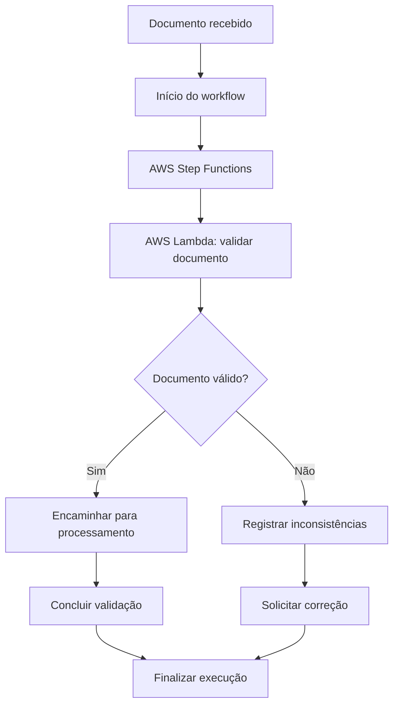

# AWS Step Functions | Orquestração de Workflows Automatizados

[](https://aws.amazon.com/pt/)
[](https://www.dio.me/)
[](./)

## Sobre o projeto

Este repositório documenta os conhecimentos adquiridos no laboratório de **AWS Step Functions**, realizado durante a formação da DIO.

O conteúdo aborda orquestração de serviços, workflows visuais, integração com AWS Lambda e a relação do AWS CloudFormation com a infraestrutura necessária para soluções em nuvem. O repositório também apresenta um estudo de caso conceitual para relacionar os conceitos a um cenário industrial.

> **Escopo:** a integração com CloudFormation foi acompanhada durante a aula. A criação e execução de funções Lambda foram demonstradas no laboratório. O estudo de caso industrial é uma proposta arquitetural conceitual, não uma solução implantada em uma conta AWS.

## Objetivos de aprendizagem

- Compreender o papel da orquestração de serviços na AWS.
- Identificar os elementos de um workflow e de uma máquina de estados.
- Entender como o Step Functions coordena etapas e serviços.
- Conhecer a integração entre Step Functions e AWS Lambda.
- Compreender a relação entre workflows e AWS CloudFormation.
- Documentar aprendizados técnicos de forma clara e versionada no GitHub.

## 1. AWS Step Functions

O AWS Step Functions é um serviço de orquestração de workflows que permite coordenar aplicações e serviços por meio de fluxos de trabalho visuais. Ele ajuda a organizar processos em etapas, controlar transições e acompanhar execuções.

Uma característica importante é que o desenho do workflow pode começar antes de todos os recursos estarem provisionados. A definição do fluxo e a configuração das integrações podem evoluir junto com a arquitetura.

### Conceitos fundamentais

| Conceito | Descrição |
|---|---|
| Workflow | Processo organizado em etapas que serão executadas conforme uma lógica definida. |
| State Machine | Definição que descreve os estados e as transições do workflow. |
| State | Etapa individual da máquina de estados. |
| Orquestração | Coordenação da execução de tarefas e serviços para atingir um objetivo. |
| Execution | Instância de execução de uma máquina de estados. |

## 2. Integração com serviços AWS

### AWS Lambda

AWS Lambda é um serviço de computação sem servidor (*serverless*) que executa código em resposta a eventos ou invocações, sem que seja necessário administrar diretamente servidores.

No laboratório, foi acompanhada a criação e a execução de funções Lambda integradas ao AWS Step Functions. Nessa arquitetura, o Step Functions coordena o processo e a função Lambda executa uma tarefa específica.

Exemplos de tarefas que podem ser atribuídas a uma função:

- Validar dados recebidos.
- Transformar ou enriquecer informações.
- Aplicar regras de negócio.
- Retornar um resultado para a próxima etapa do workflow.

Detalhes complementares: [Integração com AWS Lambda](./docs/integracao-lambda.md).

### AWS CloudFormation

AWS CloudFormation é um serviço de infraestrutura como código (*Infrastructure as Code — IaC*). Ele permite descrever recursos de infraestrutura em templates e utilizá-los para provisionar e gerenciar esses recursos.

Durante o laboratório, foi acompanhada a integração do CloudFormation com o Step Functions. Essa relação é relevante porque a automação de processos também depende da definição e da organização da infraestrutura que sustenta a solução.

> A atividade de CloudFormation foi acompanhada na aula. Este repositório não afirma que uma stack foi criada ou implantada pela autora.

Mais detalhes: [CloudFormation e infraestrutura como código](./docs/cloudformation.md).

## 3. Benefícios da orquestração

- **Visibilidade:** representação visual das etapas e transições do processo.
- **Organização:** divisão de processos em tarefas menores e compreensíveis.
- **Integração:** coordenação de serviços e aplicações.
- **Automação:** redução de atividades manuais na passagem de informações entre etapas.
- **Acompanhamento:** visualização do estado e do resultado das execuções.
- **Evolução:** possibilidade de ampliar o workflow conforme novas necessidades surgem.

## 4. Estudo de caso conceitual: validação de documentos técnicos industriais

### Contexto

Em uma operação industrial, documentos técnicos podem precisar passar por verificações antes de serem encaminhados para análise ou processamento. Quando essas etapas são realizadas manualmente, podem ocorrer atrasos, inconsistências e dificuldades para acompanhar o andamento das solicitações.

A proposta é utilizar o AWS Step Functions para coordenar um fluxo de validação inicial de documentos, com tarefas executadas por funções AWS Lambda.

### Objetivo

Organizar o recebimento, a validação e o encaminhamento de documentos técnicos, deixando explícitos os caminhos para documentos válidos e documentos que apresentam inconsistências.

### Fluxo proposto



### Etapas

1. **Recebimento:** o documento é disponibilizado para análise.
2. **Orquestração:** o Step Functions inicia e coordena as etapas definidas.
3. **Validação:** uma função Lambda verifica critérios como formato e presença de campos obrigatórios.
4. **Decisão:** o resultado da validação determina o caminho seguinte.
5. **Encaminhamento:** documentos válidos seguem para processamento; documentos com inconsistências são direcionados para correção.
6. **Finalização:** o workflow encerra a execução após registrar o resultado.

### Responsabilidades dos serviços

| Serviço | Responsabilidade na proposta |
|---|---|
| AWS Step Functions | Coordenar as etapas e os caminhos do workflow. |
| AWS Lambda | Executar a lógica de validação do documento. |
| AWS CloudFormation | Definir e provisionar os recursos de infraestrutura necessários. |

**Limite da proposta:** o fluxo é uma representação conceitual para demonstrar a aplicação dos conhecimentos. Não foram criados recursos, executadas funções ou implantada uma arquitetura para este estudo de caso.

## 5. Aprendizados consolidados

O laboratório ajudou a compreender que automatizar um processo não significa apenas executar uma função isolada. Também é necessário coordenar a ordem das tarefas, definir como os resultados serão utilizados e estabelecer os caminhos que o processo poderá seguir.

O AWS Step Functions atua nessa camada de orquestração. O AWS Lambda pode executar tarefas específicas dentro do fluxo, enquanto o AWS CloudFormation permite descrever e provisionar a infraestrutura que dá suporte à solução.

Outro aprendizado importante é que o desenho do workflow pode anteceder a criação de todos os recursos. Isso permite planejar a lógica do processo e evoluir a implementação de acordo com as necessidades da arquitetura.

## 6. Possíveis evoluções

Caso o estudo de caso seja implementado futuramente em um ambiente de laboratório, algumas evoluções possíveis seriam:

- Receber documentos por meio do Amazon S3.
- Implementar as regras de validação em funções Lambda.
- Definir caminhos condicionais para aprovação ou correção.
- Adicionar tratamento de falhas e novas tentativas.
- Utilizar CloudFormation para provisionar os recursos.
- Incorporar notificações e mecanismos de acompanhamento.

Esses itens são possibilidades de evolução, não funcionalidades já implementadas.

## 7. Organização do repositório

```text
aws-step-functions-workflows/
├── README.md
├── docs/
│   ├── conceitos-fundamentais.md
│   ├── integracao-lambda.md
│   └── cloudformation.md
└── images/
    └── .gitkeep
```

## 8. Referências oficiais

- [AWS Step Functions](https://aws.amazon.com/pt/step-functions/)
- [Documentação do AWS Step Functions](https://docs.aws.amazon.com/step-functions/)
- [AWS Lambda](https://aws.amazon.com/pt/lambda/)
- [Documentação do AWS Lambda](https://docs.aws.amazon.com/lambda/)
- [AWS CloudFormation](https://aws.amazon.com/pt/cloudformation/)
- [Documentação do AWS CloudFormation](https://docs.aws.amazon.com/cloudformation/)

---

**Projeto educacional desenvolvido como parte de um desafio da DIO.**

Documentação baseada nos conteúdos estudados e acompanhados durante o laboratório. O estudo de caso apresentado é conceitual e não corresponde a uma implantação em ambiente AWS.
